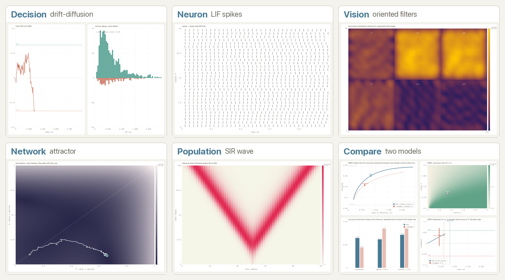
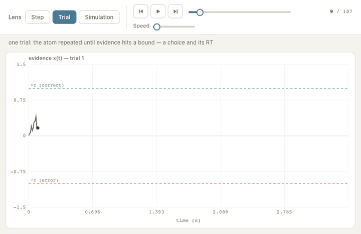

# model-scope

**Hand Claude a paper, get a live simulator.** Every parameter becomes a slider; the model re-runs as you move it.



A [Claude Code](https://docs.claude.com/en/docs/claude-code) plugin. It reads your paper, asks a few questions,
writes the model, checks the math, and serves a no-build web app — **views chosen by the model**, not a fixed plot.

## Quick start

```
/plugin marketplace add Joonoh991119/model-scope
/plugin install model-scope@joonoh-modeling
/model-scope:from-paper ./furman-wang-2008.pdf
```

Or just ask: *"build me a GUI to explore a LIF neuron as I vary input current and noise."*
Start by hand with `/model-scope:scaffold ./my-sim`. → [Install & use](docs/GUIDE.md#install)

## How it works


- **One entry per model** — `params` + `simulate()` + `views`; sliders, playback and redraw are generated. → [contract](docs/GUIDE.md#the-model-contract--add-your-own-model-in-one-entry)
- **Gated** — `validate.mjs` re-runs the same `engine.js` with analytic checks. → [validation](docs/GUIDE.md#validation--reproducibility)
- **Lenses** — structure → activity → statistics, per model class. → [levels.md](skills/model-scope/references/levels.md)
- **Zero build** — opens from `file://`, seeded RNG, linkable state, one-page bundle. → [GUI tour](docs/GUIDE.md#a-tour-of-the-gui)



## 21 worked examples

| Domain | Models |
|---|---|
| Decision | drift-diffusion · integrate vs one-sample · attractor network · POMDP tiger |
| Perception | Bayesian observer · efficient coding · causal inference |
| Memory & learning | working-memory recall · Hopfield · ring attractor · Rescorla–Wagner |
| Neurons & rhythms | LIF · Kuramoto · Wilson–Cowan |
| Vision | early vision · retina → V1 |
| Inference & attention | Bayes filter · causal DAG · self-attention · multi-head attention |
| Population | spatial SIR |

→ [what each one shows](docs/GUIDE.md#what-you-can-build--the-examples-that-ship) ·
[14 canonical families](skills/model-scope/references/modelbook/INDEX.md) in the modelbook ·
[why a harness, not a prompt](docs/GUIDE.md#why-a-harness--not-just-a-prompt)

## Docs

[Full guide](docs/GUIDE.md) · [plotting API](skills/model-scope/references/plotting.md) ·
[GUI QC](skills/model-scope/references/gui-qc.md) · [template](skills/model-scope/assets/template/README.md) ·
[repo layout](docs/GUIDE.md#repository-layout) · [developer tests](tests/README.md)

---

MIT · Joonoh Park ([github.com/Joonoh991119](https://github.com/Joonoh991119))
