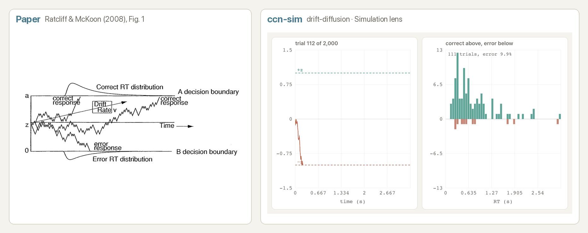
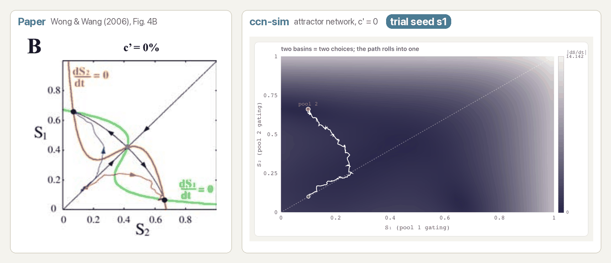
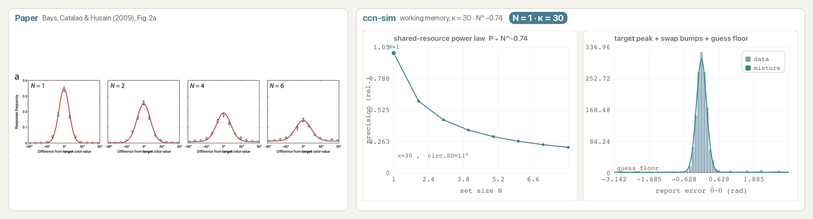
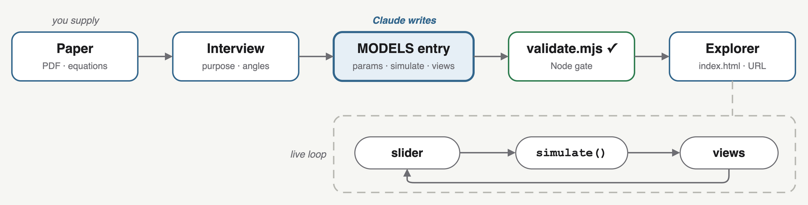

# ccn-sim

**Interactive simulators for cognitive computational neuroscience models.** Hand Claude a paper and get the
model back as a live app: every parameter is a slider, and the model re-runs as you move it.

### The paper's figure, and the same model running







<sub>Left panels are reproduced from the cited papers for comparison: Ratcliff & McKoon (2008) © MIT Press (NIH author
manuscript, PMC2474742); Wong & Wang (2006) © Society for Neuroscience, CC BY-NC-SA 4.0; Bays, Catalao & Husain (2009) © ARVO (Europe PMC author
manuscript, PMC3118422).
Right panels are screen captures of this repository's template.</sub>

A [Claude Code](https://docs.claude.com/en/docs/claude-code) plugin. It reads your paper, asks a few questions,
writes the model, checks the math, and serves a no-build web app. **The model chooses its views**; there is no fixed
plot. It is for researchers in perception, decision-making, learning, memory and neural dynamics who want to understand
a model by tuning it. An integer parameter becomes a condition selector, and a boolean becomes a toggle.

## Quick start

```
/plugin marketplace add Joonoh991119/ccn-sim
/plugin install ccn-sim@joonoh-modeling
/ccn-sim:from-paper ./wong-wang-2006.pdf
```

Or just ask: *"build me a GUI to explore a LIF neuron as I vary input current and noise."*
Start by hand with `/ccn-sim:scaffold ./my-sim`. → [Install & use](docs/GUIDE.md#install)

## How it works



- **One entry per model.** A model is `params` + `simulate()` + `views`; the sliders, playback and redraw are generated. → [contract](docs/GUIDE.md#the-model-contract--add-your-own-model-in-one-entry)
- **Gated.** `validate.mjs` re-runs the same `engine.js` with analytic checks. → [validation](docs/GUIDE.md#validation--reproducibility)
- **Lenses.** Each model class is shown as structure, then activity, then statistics. → [levels.md](skills/ccn-sim/references/levels.md)
- **Zero build.** The app opens from `file://`, with a seeded RNG, linkable state and a one-page bundle. → [GUI tour](docs/GUIDE.md#a-tour-of-the-gui)

## 21 worked examples

| Domain | Models |
|---|---|
| Decision | drift-diffusion · integrate vs one-sample · attractor network · POMDP tiger |
| Perception | Bayesian observer · efficient coding · causal inference |
| Memory & learning | working-memory recall · Hopfield · ring attractor · Rescorla–Wagner |
| Neurons & rhythms | LIF · Kuramoto · Wilson–Cowan |
| Vision | early vision · retina → V1 |
| Inference & attention | Bayes filter · causal DAG · self-attention · multi-head attention |
| Population | spatial SIR |

→ [what each one shows](docs/GUIDE.md#what-you-can-build--the-examples-that-ship) ·
[14 canonical families](skills/ccn-sim/references/modelbook/INDEX.md) in the modelbook ·
[why a harness, not a prompt](docs/GUIDE.md#why-a-harness--not-just-a-prompt)

**Not built yet:** predictive coding · Boltzmann machine · TD learning · Q-learning · actor-critic · Hodgkin–Huxley ·
leaky competing accumulator · normalization · STDP · sparse coding · successor representation · HGF … → [backlog](docs/BACKLOG.md)

## Docs

[Full guide](docs/GUIDE.md) · [backlog](docs/BACKLOG.md) · [plotting API](skills/ccn-sim/references/plotting.md) ·
[GUI QC](skills/ccn-sim/references/gui-qc.md) · [template](skills/ccn-sim/assets/template/README.md) ·
[repo layout](docs/GUIDE.md#repository-layout) · [developer tests](tests/README.md)

## References

The original papers behind the shipped examples.

- **Drift-diffusion.** Ratcliff, R. (1978). A theory of memory retrieval. *Psychological Review, 85*(2), 59–108. [doi:10.1037/0033-295X.85.2.59](https://doi.org/10.1037/0033-295X.85.2.59) · Ratcliff, R., & McKoon, G. (2008). The diffusion decision model: Theory and data for two-choice decision tasks. *Neural Computation, 20*(4), 873–922. [doi:10.1162/neco.2008.12-06-420](https://doi.org/10.1162/neco.2008.12-06-420)
- **Integrate vs one sample.** Bogacz, R., Brown, E., Moehlis, J., Holmes, P., & Cohen, J. D. (2006). The physics of optimal decision making: A formal analysis of models of performance in two-alternative forced-choice tasks. *Psychological Review, 113*(4), 700–765. [doi:10.1037/0033-295X.113.4.700](https://doi.org/10.1037/0033-295X.113.4.700)
- **Attractor decision network.** Wong, K.-F., & Wang, X.-J. (2006). A recurrent network mechanism of time integration in perceptual decisions. *Journal of Neuroscience, 26*(4), 1314–1328. [doi:10.1523/JNEUROSCI.3733-05.2006](https://doi.org/10.1523/JNEUROSCI.3733-05.2006)
- **Bayesian observer.** Jazayeri, M., & Shadlen, M. N. (2010). Temporal context calibrates interval timing. *Nature Neuroscience, 13*(8), 1020–1026. [doi:10.1038/nn.2590](https://doi.org/10.1038/nn.2590) · Petzschner, F. H., Glasauer, S., & Stephan, K. E. (2015). A Bayesian perspective on magnitude estimation. *Trends in Cognitive Sciences, 19*(5), 285–293. [doi:10.1016/j.tics.2015.03.002](https://doi.org/10.1016/j.tics.2015.03.002)
- **Efficient coding.** Wei, X.-X., & Stocker, A. A. (2015). A Bayesian observer model constrained by efficient coding can explain "anti-Bayesian" percepts. *Nature Neuroscience, 18*(10), 1509–1517. [doi:10.1038/nn.4105](https://doi.org/10.1038/nn.4105)
- **Causal inference.** Körding, K. P., Beierholm, U., Ma, W. J., Quartz, S., Tenenbaum, J. B., & Shams, L. (2007). Causal inference in multisensory perception. *PLoS ONE, 2*(9), e943. [doi:10.1371/journal.pone.0000943](https://doi.org/10.1371/journal.pone.0000943)
- **Working memory.** Bays, P. M., & Husain, M. (2008). Dynamic shifts of limited working memory resources in human vision. *Science, 321*(5890), 851–854. [doi:10.1126/science.1158023](https://doi.org/10.1126/science.1158023) · Bays, P. M., Catalao, R. F. G., & Husain, M. (2009). The precision of visual working memory is set by allocation of a shared resource. *Journal of Vision, 9*(10), 7. [doi:10.1167/9.10.7](https://doi.org/10.1167/9.10.7)
- **Early vision.** Adelson, E. H., & Bergen, J. R. (1985). Spatiotemporal energy models for the perception of motion. *JOSA A, 2*(2), 284–299. [doi:10.1364/JOSAA.2.000284](https://doi.org/10.1364/JOSAA.2.000284)
- **Retina → V1.** Hubel, D. H., & Wiesel, T. N. (1962). Receptive fields, binocular interaction and functional architecture in the cat's visual cortex. *Journal of Physiology, 160*(1), 106–154. [doi:10.1113/jphysiol.1962.sp006837](https://doi.org/10.1113/jphysiol.1962.sp006837) · Enroth-Cugell, C., & Robson, J. G. (1966). The contrast sensitivity of retinal ganglion cells of the cat. *Journal of Physiology, 187*(3), 517–552. [doi:10.1113/jphysiol.1966.sp008107](https://doi.org/10.1113/jphysiol.1966.sp008107)
- **LIF neuron.** Lapicque, L. (1907). Recherches quantitatives sur l'excitation électrique des nerfs traitée comme une polarisation. *Journal de Physiologie et de Pathologie Générale, 9*, 620–635. English translation: Brunel, N., & van Rossum, M. C. W. (2007). *Biological Cybernetics, 97*(5–6), 341–349. [doi:10.1007/s00422-007-0189-6](https://doi.org/10.1007/s00422-007-0189-6)
- **Rescorla–Wagner.** Rescorla, R. A., & Wagner, A. R. (1972). A theory of Pavlovian conditioning: Variations in the effectiveness of reinforcement and nonreinforcement. In A. H. Black & W. F. Prokasy (Eds.), *Classical conditioning II* (pp. 64–99). Appleton-Century-Crofts.
- **SIR epidemic.** Kermack, W. O., & McKendrick, A. G. (1927). A contribution to the mathematical theory of epidemics. *Proceedings of the Royal Society A, 115*(772), 700–721. [doi:10.1098/rspa.1927.0118](https://doi.org/10.1098/rspa.1927.0118)
- **Hopfield network.** Hopfield, J. J. (1982). Neural networks and physical systems with emergent collective computational abilities. *PNAS, 79*(8), 2554–2558. [doi:10.1073/pnas.79.8.2554](https://doi.org/10.1073/pnas.79.8.2554)
- **Kuramoto oscillators.** Kuramoto, Y. (1975). Self-entrainment of a population of coupled non-linear oscillators. In H. Araki (Ed.), *International Symposium on Mathematical Problems in Theoretical Physics* (Lecture Notes in Physics, Vol. 39, pp. 420–422). Springer. [doi:10.1007/BFb0013365](https://doi.org/10.1007/BFb0013365)
- **Bayes filter.** Rabiner, L. R. (1989). A tutorial on hidden Markov models and selected applications in speech recognition. *Proceedings of the IEEE, 77*(2), 257–286. [doi:10.1109/5.18626](https://doi.org/10.1109/5.18626)
- **Ring attractor.** Ben-Yishai, R., Bar-Or, R. L., & Sompolinsky, H. (1995). Theory of orientation tuning in visual cortex. *PNAS, 92*(9), 3844–3848. [doi:10.1073/pnas.92.9.3844](https://doi.org/10.1073/pnas.92.9.3844) · Compte, A., Brunel, N., Goldman-Rakic, P. S., & Wang, X.-J. (2000). Synaptic mechanisms and network dynamics underlying spatial working memory in a cortical network model. *Cerebral Cortex, 10*(9), 910–923. [doi:10.1093/cercor/10.9.910](https://doi.org/10.1093/cercor/10.9.910)
- **Causal graph.** Pearl, J. (2009). *Causality: Models, reasoning, and inference* (2nd ed.). Cambridge University Press. [doi:10.1017/CBO9780511803161](https://doi.org/10.1017/CBO9780511803161)
- **Self- and multi-head attention.** Vaswani, A., Shazeer, N., Parmar, N., Uszkoreit, J., Jones, L., Gomez, A. N., Kaiser, Ł., & Polosukhin, I. (2017). Attention is all you need. *Advances in Neural Information Processing Systems, 30*. [arXiv:1706.03762](https://doi.org/10.48550/arXiv.1706.03762)
- **POMDP.** Kaelbling, L. P., Littman, M. L., & Cassandra, A. R. (1998). Planning and acting in partially observable stochastic domains. *Artificial Intelligence, 101*(1–2), 99–134. [doi:10.1016/S0004-3702(98)00023-X](https://doi.org/10.1016/S0004-3702%2898%2900023-X)
- **Wilson–Cowan.** Wilson, H. R., & Cowan, J. D. (1972). Excitatory and inhibitory interactions in localized populations of model neurons. *Biophysical Journal, 12*(1), 1–24. [doi:10.1016/S0006-3495(72)86068-5](https://doi.org/10.1016/S0006-3495%2872%2986068-5)

---

MIT · Joonoh Park ([github.com/Joonoh991119](https://github.com/Joonoh991119))
